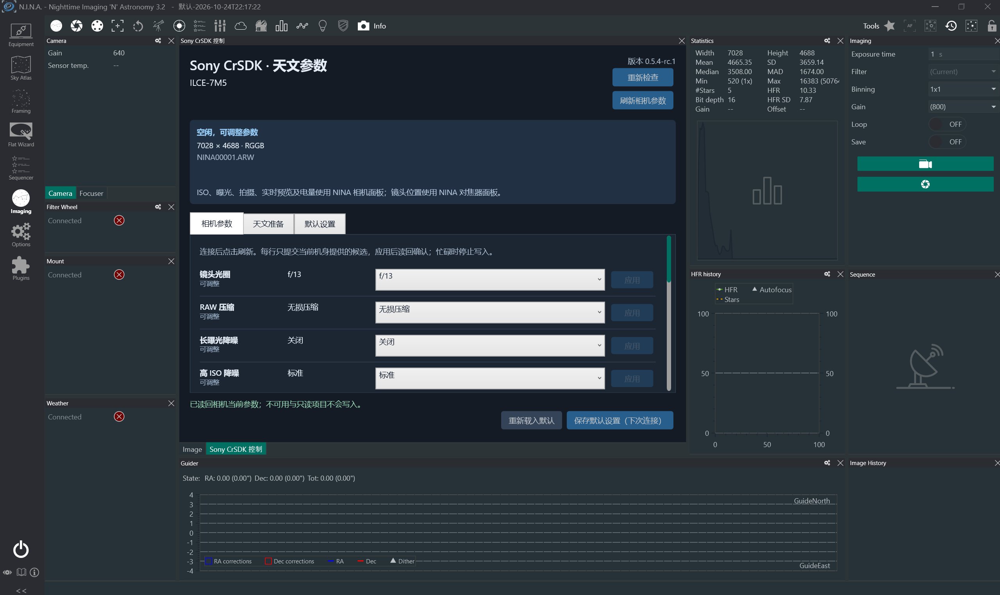

# Sony CrSDK Camera Plugin for N.I.N.A.

通过 Sony Camera Remote SDK，让 Sony 相机在 N.I.N.A. 中完成曝光、完整 ARW 接收、Bayer RAW 解码及 FITS/XISF 保存。

**当前版本：[0.5.6](https://github.com/isky-zh-l/Sony-CrSDK-Camera-Plugin-for-NINA/releases/latest)**

作者：[isky](https://github.com/isky-zh-l)。独立社区项目，与 Sony 或 N.I.N.A. 官方无隶属或认证关系。

## 功能与支持范围

- 普通曝光、软件 Bulb、ISO/快门控制、JPEG LiveView 和原始 ARW 可选副本。
- Sony 控制面板提供相机参数、天文设置与恢复，和 N.I.N.A. 标准相机入口共享连接。
- 启动时只检测已配置的 SDK；首次使用在插件的 **SDK 配置** 页导入一次，配置与个人设置在插件升级时保留。
- 已知可纠正设置问题支持重新检查；取消及错误处理阻止不确定帧和旧帧交付。
- 已验证机型：Sony A7 V（ILCE-7M5）。具体支持范围见 [兼容性](docs/COMPATIBILITY.md)。

其他机型需分别验证。镜头对焦器为可选实验功能；不支持多相机并行、硬件 binning、RAW ROI、制冷或科学视频。

## 安装与使用

需要 **Windows x64、N.I.N.A. 3.2.0.9001、Sony SDK 2.02.00 Windows x64** 和 VC++ x64 运行库。Sony SDK 需用户自行从官方取得，发布包不捆绑 SDK、宿主或驱动。

1. 在对应版本发布页下载插件 ZIP 和 `SHA256SUMS`，校验后解压。
2. 插件收录社区目录前，运行包内 `Install.ps1` 手动安装（收录后可直接在插件管理器安装）。安装并重启后，插件启动**只检测** SDK，不会自动安装；首次请在插件设置 → **SDK 配置** 中导入一次。
3. 机身设置 M、MF、仅 RAW、Single Shooting，在 N.I.N.A. 选择 **Sony CrSDK Camera**。开启保存，先拍一张短曝光。

[完整安装与卸载教程](docs/INSTALL.md) · [参数和保存设置](docs/USAGE.md) · [兼容性](docs/COMPATIBILITY.md)

## 界面与架构

源码位于 `src/native`、`src/managed` 和 `src/nina`；三层职责见 [架构说明](docs/ARCHITECTURE.md)，编译与离线检查见 [构建说明](docs/BUILD.md)。普通安装无需编译。

## 反馈与许可

通过 Issues 提供版本、型号/固件/RAW 模式、复现步骤和脱敏日志。请勿上传私人配置、设备标识或未授权照片。

项目自有代码采用 [MIT](LICENSE)，LibRaw 保留自身许可，详见 [第三方说明](THIRD-PARTY-NOTICES.md)。项目实质性使用了 AI 辅助开发，维护者负责集成、验证与维护决策。
