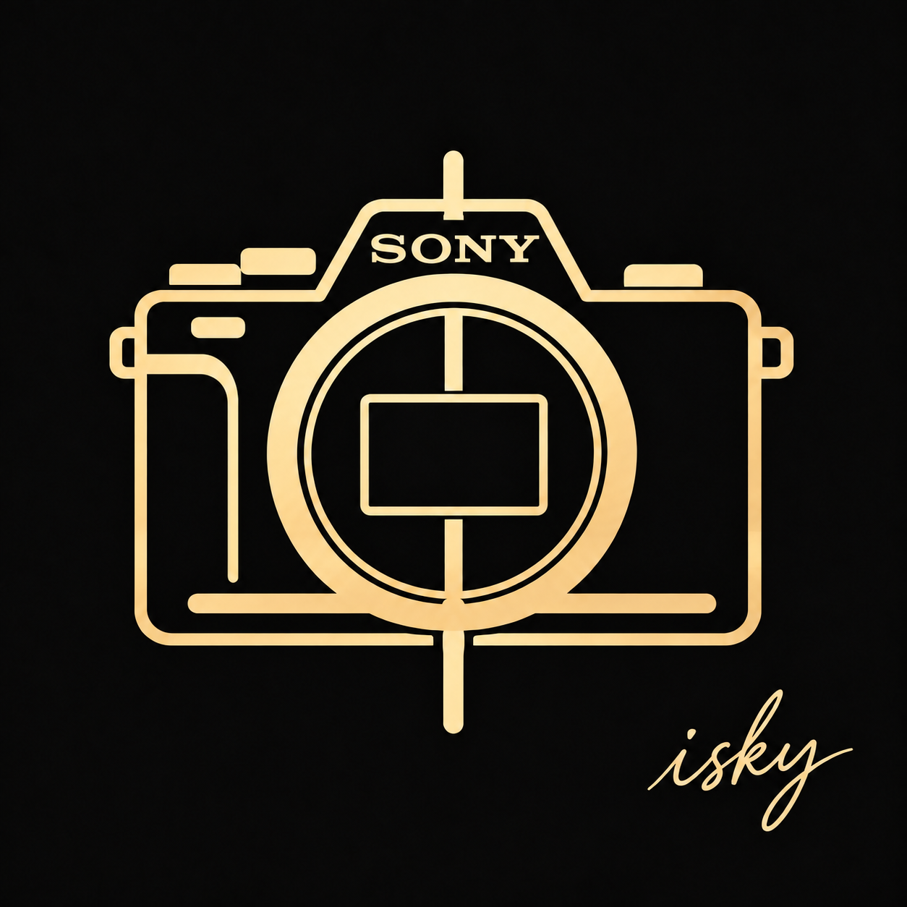

# Sony CrSDK Camera Plugin for N.I.N.A.



**让 新型 Sony 相机接入 N.I.N.A.**

基于 Sony Camera Remote SDK 开发、运行于 Windows 的 N.I.N.A. 相机插件，提供相机连接、曝光控制、完整 ARW 文件接收与 LiveView，并将图像交给 N.I.N.A. 现有的处理及保存流程。

作者与维护者：**[isky](https://github.com/isky-zh-l)**

> 当前仅在 **Sony A7 V（ILCE-7M5）** 上完成所列功能的实机验证。其他机型尚未验证，不能因 Sony SDK 支持某机型就推定本插件已兼容。

> 本项目为独立社区项目，与 Sony 或 N.I.N.A. 官方无隶属关系，未获得其官方认证或背书。

## 为什么开发

这个项目起于一个具体需求：让自己的 A7 V 能在 N.I.N.A. 中稳定拍摄，并完整取回照片。

在维护者早期使用的 MTP/WPD 取图路径中，遇到了 ARW 文件接收不完整的问题。本项目改用 Sony Camera Remote SDK，并针对 A7 V 的 ARW6 提供私有解码路径，将像素数据交给 N.I.N.A.，以继续使用它的序列拍摄、图像处理和存盘功能。

希望它能逐步成为更多 Sony 用户可使用、可排查问题的相机插件。新增机型将以实际测试和明确的支持记录为依据。

## 当前功能

- 通过 CrSDK 枚举、连接及断开 A7 V。
- 设置 ISO 与曝光时间，支持普通曝光及软件 Bulb。
- 接入 N.I.N.A. 拍摄序列，接收完整 ARW，并通过私有 LibRaw 解码。
- 由 N.I.N.A. 按保存设置输出 FITS/XISF 等图像，可选另存原始 ARW 副本。
- JPEG LiveView，支持彩色与灰度配置。
- 取消曝光、连接失败后的重试，以及拔插后手动重新连接。

中断的曝光明确报告失败，不自动补传无法确认归属的卡内文件。

## 环境与验证范围

| 项目 | 当前开发与实测范围 |
|---|---|
| 操作系统 | Windows x64 |
| 相机 | Sony A7 V / ILCE-7M5，单相机 USB 连接 |
| N.I.N.A. | 3.2.0.9001 |
| Sony SDK | 2.02.00 |
| 托管运行环境 | .NET 8 |
| RAW 格式 | 已验证 Compressed；其他格式待验证 |


当前开发版本新增了灰度预览配置，并修复了连接前置条件不满足后无法正常重试的问题。维护者已确认错误模式下连接失败、改正模式后可重新连接。


尚不支持多相机并行、硬件 binning、RAW ROI、制冷控制或科学视频录制。尚未进入 N.I.N.A. 官方社区插件列表。

## 安装与开始使用

普通用户请在 [Releases](https://github.com/isky-zh-l/Sony-CrSDK-Camera-Plugin-for-NINA/releases) 下载插件二进制包（发布后提供），无需安装编译工具。GitHub 自动生成的 Source code ZIP 是源码，不是插件安装包。首次公开发布前，可使用维护者提供的同版候选 ZIP。

### 1. 下载插件并自行获取 Sony SDK

**仓库及公开发布包不附带 Sony SDK 的头文件、lib、DLL 或驱动。**

请通过 [Sony 官方许可与下载入口](https://support.d-imaging.sony.co.jp/app/sdk/licenseagreement_d/en.html) 自行阅读并接受条款，取得 Windows x64 SDK。默认开发目录如下：

```text
deps/sony/SimpleCli/
  app/CRSDK/CameraRemote_SDK.h
  external/crsdk/Cr_Core.lib
  external/crsdk/Cr_Core.dll
  external/crsdk/CrAdapter/...
```

也可使用其他目录，构建时通过 `-SonySdkRoot` 指定。`deps/` 不进入版本控制。相机 USB 设置与驱动安装遵循 Sony 官方说明。

### 2. 安装或从源码构建

构建需要 .NET 8 SDK、MSVC x64、CMake、Ninja，以及目标版本 N.I.N.A.。

```powershell
.\build.ps1 -Native -SonySdkRoot '<官方SimpleCli目录>' -NinaApp '<NINA安装目录>'
```

以上命令仅供开发者从源码构建。普通用户无需编译：解压二进制包，右键使用 PowerShell 运行 `Install.ps1`，或按以下方式显式传入路径：

```powershell
.\Install.ps1 -SonySdkRoot '<官方SimpleCli目录>' -NinaApp '<NINA安装目录>'
```

安装前退出 N.I.N.A.；脚本会校验本包与 SDK 版本、备份将要替换的文件，并将 SDK 运行库从你自己的本地目录复制到所需位置。不会自动下载 SDK、安装驱动或连接相机。详细步骤及卸载方法见 [安装说明](docs/INSTALL.md)。安装后的目录含本机 SDK 文件，不要将它重新打包公开转发。

### 3. 相机和保存设置

- 相机使用 **M（手动曝光）、MF（手动对焦）、仅 RAW、单张拍摄（Single Shooting）**；其他拍摄前置条件以插件提示为准。单张拍摄指机身每次响应一次拍摄请求，不影响 N.I.N.A. 序列逐张连续拍摄。
- N.I.N.A. 中选择本插件，设置输出目录与 FITS/XISF 格式。
- 手动快照如需保存及查看保存历史，请打开拍摄面板的保存开关。
- 首次使用先完成一张短曝光，再开始长序列。

## 配置

编辑插件目录中的 `settings.json`，断开并重新连接相机后生效：

```json
{
  "saveOriginalRaw": "never",
  "rawCopyFolder": "raw",
  "liveViewColor": true
}
```

默认不额外保留 ARW 副本；如需同时保留原始 ARW，将 `saveOriginalRaw` 改为 `also`。

| 设置 | 含义 |
|---|---|
| `saveOriginalRaw: "never"` | 不额外保留 ARW 副本；不影响 N.I.N.A. 保存 FITS/XISF |
| `saveOriginalRaw: "also"` | 同时在 N.I.N.A. 输出根目录的指定子目录保留原始 ARW |
| `rawCopyFolder` | 原始副本子目录名称，默认 `raw` |
| `liveViewColor` | `true` 为彩色，`false` 为灰度；不改变实际曝光的 RAW 像素 |

`never` 不删除相机卡内文件、既有 ARW 副本或 SDK 临时接收文件。保留的旧 `only` 模式可能遇到 N.I.N.A. 自带 ARW6 缩略图解码问题，不推荐使用。

## 反馈与参与

欢迎通过 Issues 报告故障、提交适配记录或讨论改进。请尽量提供：

- 相机型号、固件与 RAW 格式。
- Windows、N.I.N.A.、插件及 SDK 版本。
- 复现步骤、预期与实际表现。
- 问题发生时间及对应 N.I.N.A. 日志片段。

上传前检查日志和照片中的个人路径、设备标识及其他私人信息。其他型号用户请先交流测试方案；没有实测结果前，不将其列为已支持机型。

## AI 辅助开发说明

本项目在需求梳理、代码实现、问题分析、文档与视觉设计中使用了 AI 工具，包括 GPT 系列与 DeepSeek。AI 使用在本项目中具有实质性作用，并非仅用于补全代码。

维护者负责项目方向、集成、实机测试和维护决策。代码审查、依赖来源核对与测试记录将持续完善；AI 生成内容不等于已验证正确，构建和替身测试也不代替真机验证。


## 开发结构

```text
N.I.N.A. → 第三模块：NINA 适配层 ─┐
独立 C# 图形与验收工具 ─────────┴→ 第二模块：通用 C# 客户端
                                            ↓ P/Invoke
                                  第一模块：C++ / C ABI 包装
                                            ↓
                                     Sony CrSDK → 相机
```

Sony SDK 更新主要由第一模块适配，N.I.N.A. 接口更新主要由第三模块适配；跨模块接口与运行库布局发生变化时，仍需协调更新并进行集成验证。

## 许可与致谢

项目自有代码沿用 [MIT License](LICENSE)。LibRaw 保留自身许可和对应源码；Sony SDK、N.I.N.A. 及其他依赖不由本项目重新授权。详见 [第三方说明](THIRD-PARTY-NOTICES.md)。

感谢 N.I.N.A.、LibRaw、Sony Camera Remote SDK，以及愿意参与测试与反馈的用户。

如果项目对你有帮助，欢迎 Star 关注后续更新；可复现的问题报告、测试记录和代码贡献同样受到欢迎。

