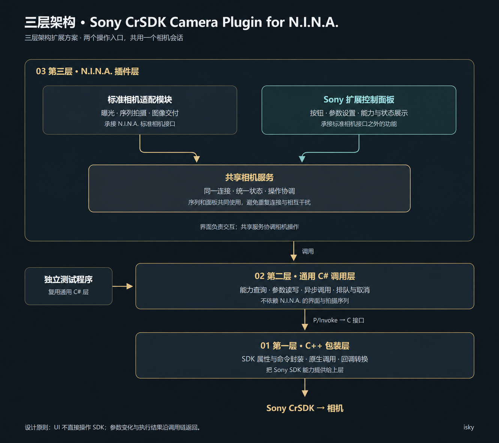
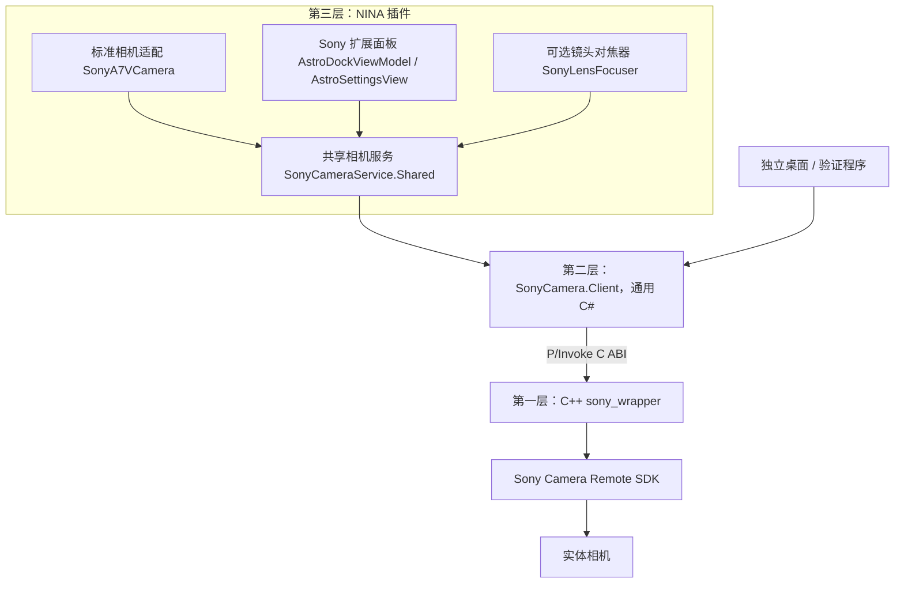

# 三层架构与共享相机会话（0.5.4-rc.1）

## 对照设计图

第三层的标准相机适配负责承接 NINA 曝光、图像交付和预览接口；扩展面板承接标准接口以外的参数与状态。两者使用同一个静态共享服务与相机会话。可停靠面板通过 NINA IDockableVM 导出、按类型匹配 DataTemplate，出现在成像工作区的工具面板列表中；插件选项和相机设置窗口仍可打开同一套控件。

UI 只依赖 IAstroSettingsSession，不持有原生句柄、不 P/Invoke、不创建 SonyCameraClient，也不自行连接相机。共享服务调用通用客户端；第二层不引用 NINA、WPF 或其序列模型，可被独立程序复用。第一层保留 C ABI、原生参数/命令封装和回调转换。

## 操作协调

服务协调器统一串行化连接/释放、普通 ISO/快门、参数检查和写入、天文准备/恢复、镜头状态/移动、预览启停/读帧、拍摄提交、取消/提前结束以及图像交付。操作开始和结束向两个入口通知同一状态，忙碌、未确认连接和曝光中的参数写入被拒绝；过期连接/当前值不能提交。

预览参数变化的“停止流、更新 ISO/快门、重新开启流”由服务在一次协调操作内完成，适配器只提交意图。启动拍摄时服务在同一操作内停止预览，避免两个入口在各步骤间互相插入。

等待完整曝光期间不持有服务协调器，取消操作仍可进入；完成后重新取得协调器并核对连接/拍摄身份，再发布结果。SDK 实际调用仍在第二层唯一 owner 线程的命令队列上执行。读预览帧不逐帧广播忙碌状态，避免给 UI 造成额外刷新负担。观察者抛错不会中断相机操作或阻止其他入口接收状态。

共享会话指同一个 NINA 进程内的共享；独立测试程序复用第二层代码，不与 NINA 跨进程共用句柄，不能同时占用同一实体相机。

## 本次界面改动

- 取消产品中的机身对焦放大入口，使用 NINA 电脑图像预览缩放；NINA 参数查询不再包含放大项，独立工作台也不显示放大/放大时间/初始放大设置。
- ABI 中的历史属性编号保留，底层对焦放大写入仍被拒绝，避免二进制兼容性破坏；这不构成保留产品功能。
- 控件上的滚轮交给最近可滚动的页面，内层到边界时可继续传向外层；关闭的下拉框不因滚轮改变选项，展开的菜单保留原有行为。
- 使用像素滚动，按系统滚动行数及原始 delta 计算位移，保留高精度滚轮的小幅输入。

架构说明不扩大机型兼容承诺，具体实机范围见 [验证说明](VALIDATION.md)。
